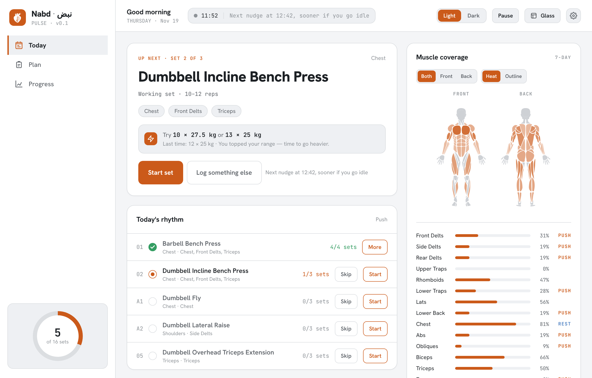
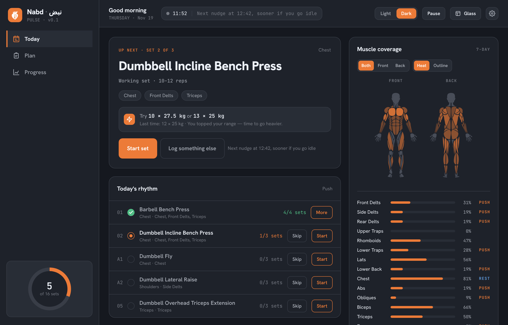
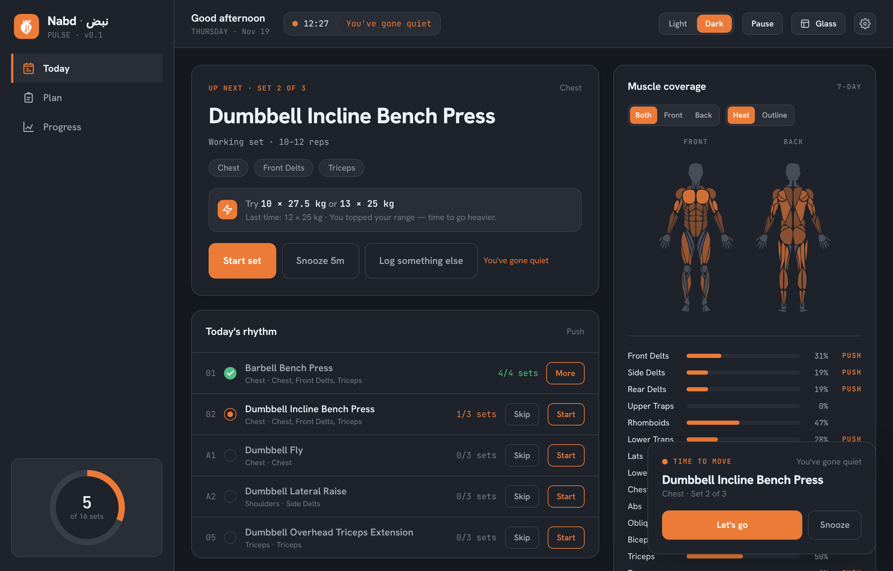
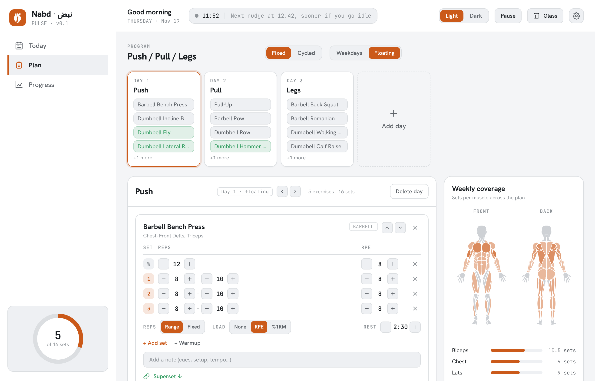
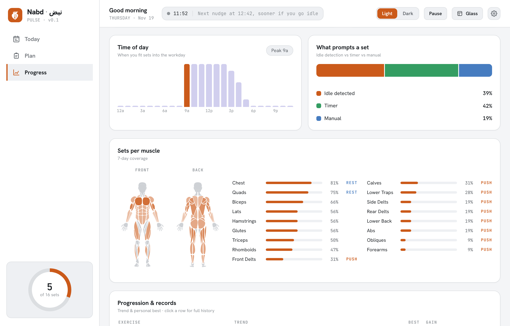
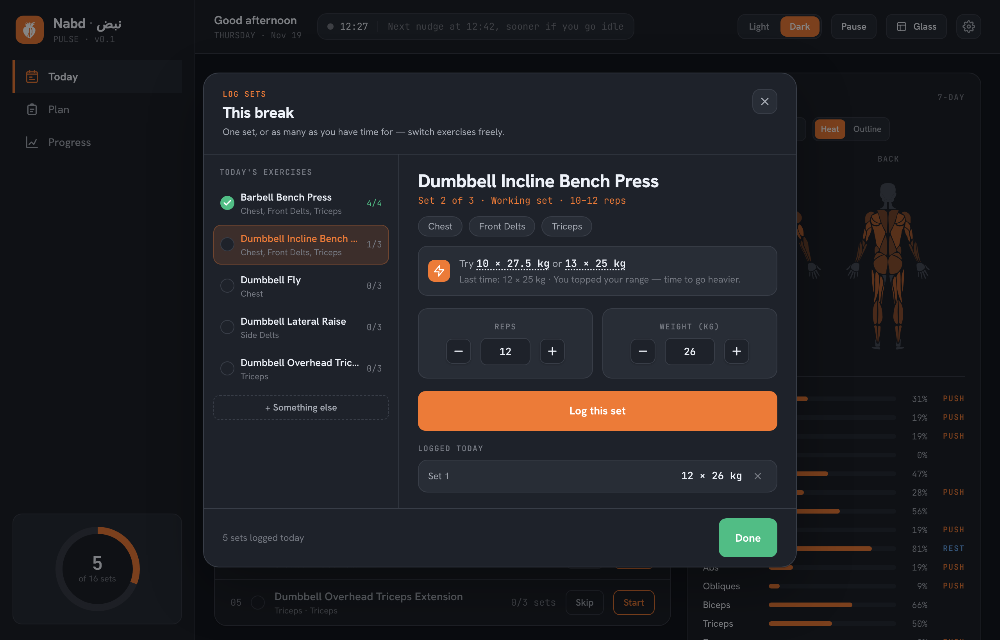

# Nabḍ · نبض

Your workout, spread across the workday, one set at a time.

<p align="center">
  
  
</p>

## Why

So much of a working day is now prompting something and waiting for it: an AI agent
working through a task, a build, a long test run. That wait is too short to start
anything else and too long to just stare at the screen — but it is about the length of a
set.

And when the office sits side by side with the home gym, a set is ten steps away. There
is no need to block out an hour for a session: the workout can happen in the gaps.

So Nabḍ sits in the tray and nudges you when it is a good moment. You do one set, log it,
and go back to work. By the end of the day the plan is done, and it knows what to suggest
next time.

## Screenshots

<table>
  <tr>
    <td width="50%"></td>
    <td width="50%"></td>
  </tr>
  <tr>
    <td><b>Today.</b> What's next and the day's queue; a nudge says it's time for a set.</td>
    <td><b>Planner.</b> Days of exercises, sets, rep ranges, RPE, supersets and rest.</td>
  </tr>
  <tr>
    <td></td>
    <td></td>
  </tr>
  <tr>
    <td><b>Progress.</b> When and why you train, and a body map of the week's sets per muscle.</td>
    <td><b>Logging a set.</b> The logger suggests the next target from your last session.</td>
  </tr>
</table>

## Features

- **Nudges** after a set interval, or earlier at an idle moment (no keyboard or mouse),
  but never sooner than a minimum gap, and only within your workday. Pause or snooze
  whenever you like.
- **Plans** that are fixed (set exercises per day) or cycled (each day trains muscles,
  rotating through a pool of exercises), pinned to weekdays or floating Day 1, 2, 3…
- **Smart progression:** double progression against your last session, a step back after
  two sessions below your range, and loads from an RPE or a %1RM of your estimated max.
- **Logging** one set or several per break, in any order: supersets, rest timers, skips
  and extras.
- **Your data stays local** in a SQLite database on your machine, with export and import
  as JSON.
- **Glass:** an optional translucent window (off by default; Windows and macOS).
- **Windows, macOS and Linux**, built with Tauri 2.

## Install

Download the installer for your OS from the
[latest release](https://github.com/mewais/Nabd/releases/latest):

- **Windows 10/11:** `.exe` (setup) or `.msi`
- **macOS 11 or later:** `.dmg` (one universal app for Apple silicon and Intel)
- **Linux:** `.deb` (Debian, Ubuntu) or `.rpm` (Fedora, openSUSE)

The builds are not code-signed, so the first launch comes with a warning:

- **Windows:** SmartScreen says it "protected your PC"; choose _More info → Run anyway_.
- **macOS:** Gatekeeper refuses to open the app; allow it in _System Settings → Privacy &
  Security → Open Anyway_ (on older macOS, right-click the app and choose _Open_).
- **Linux:** the tray needs a StatusNotifier host: KDE has one, GNOME needs the
  AppIndicator extension. Without one Nabḍ runs as an ordinary window.

More in [platform support](docs/platforms.md).

## Build from source

With Node 20+, pnpm and Rust, plus your platform's
[prerequisites](docs/development.md#prerequisites):

```bash
pnpm install
pnpm tauri dev      # the desktop app
pnpm tauri build    # installers, in src-tauri/target/release/bundle
```

[docs/development.md](docs/development.md) has the checks, tests and how to cut a
release.

## Documentation

- [How it works](docs/how-it-works.md): plans, Today, nudges, logging and suggestions, in
  detail
- [Platform support](docs/platforms.md): what each OS and desktop gets
- [Development](docs/development.md): prerequisites, checks, end-to-end tests,
  screenshots, releases
- [Architecture](docs/architecture.md): the packages and crates, and how they depend on
  each other
- [Smoke test](docs/smoke-test.md): the checks run on the real app on each platform

## Credits

- Body-map SVG paths vendored from
  [react-native-body-highlighter](https://github.com/HichamELBSI/react-native-body-highlighter)
  (MIT, © 2022 ELABBASSI Hicham) — `packages/bodymap/src/drawing/LICENSE`.
- Bundled fonts: Hanken Grotesk and JetBrains Mono (SIL Open Font License 1.1) —
  `packages/app/public/fonts/OFL.txt`.
- Full attribution is in `NOTICE`.

## License

MIT, © 2026 Mohammad Ewais. See [LICENSE](LICENSE).
